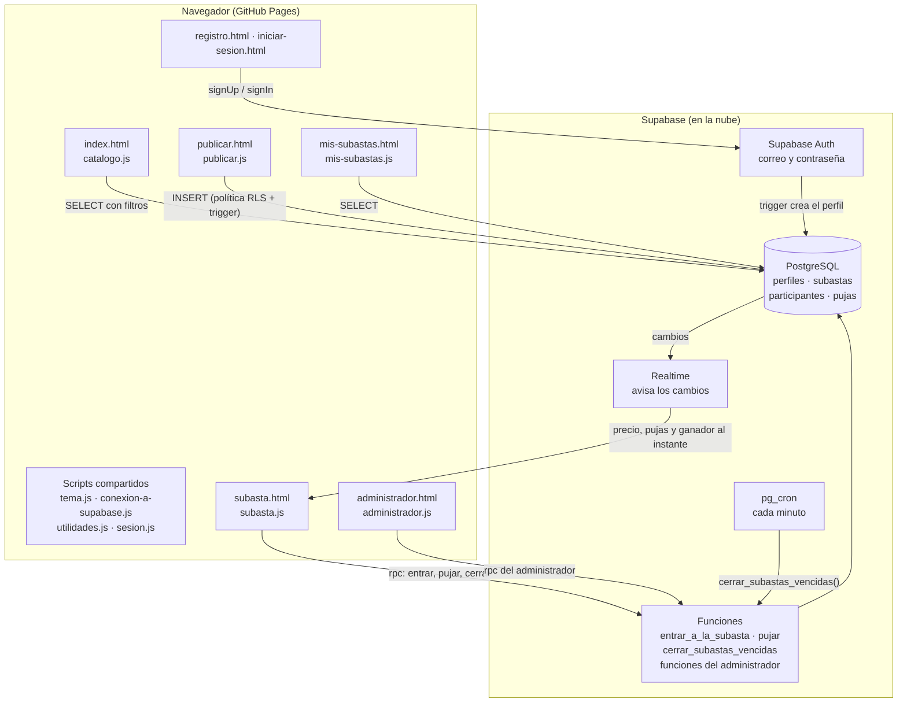
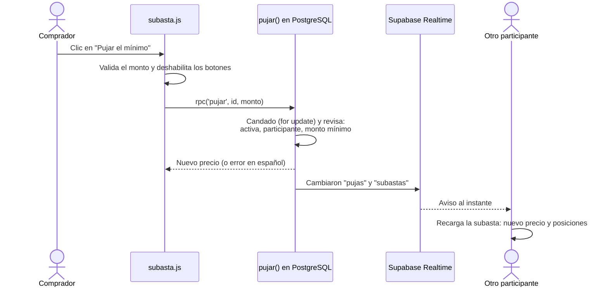

# Subastas AW

Proyecto final de **Aplicaciones Web** (UABC FIAD Ensenada, 2026-2).

Plataforma de subastas en línea donde los vendedores publican productos y los compradores pujan por ellos.

🌐 **Página publicada:** https://zygadiel.github.io/subastas-aw/

## ¿Cómo funciona?

- Cada subasta acepta **solo 5 participantes**; los lugares se asignan por orden de llegada.
- El vendedor define el **precio inicial**, el **incremento mínimo** y la **duración**.
- Quien no alcanzó lugar puede **ver la subasta** sin ver los datos personales de los participantes.
- Al terminar el tiempo, la subasta **se cierra sola** y gana la puja más alta.
- La página cobra una **comisión del 3 %** sobre la venta.

## Tipos de usuario

| Rol | Puede |
|---|---|
| Comprador | Registrarse, buscar y filtrar productos, entrar a subastas, pujar, ver si ganó |
| Vendedor | Publicar productos con fotos, ver participantes (anónimos) y el ganador |
| Administrador | Suspender usuarios, eliminar publicaciones, ver estadísticas |

## Mapa del sistema

Cada página es un archivo HTML con su propio JavaScript. Todas cargan los mismos 4 scripts compartidos y hablan **directo** con Supabase. No hay un servidor propio en medio: la seguridad la ponen la base de datos (reglas, políticas RLS y funciones) y Supabase Auth.

### Recorrido de una puja

## Casos límite cubiertos (para la demo)

| Caso | Qué pasa | Dónde se detiene |
|---|---|---|
| Dos personas quieren el último de los 5 lugares al mismo tiempo | Solo uno entra; el otro ve "ya tiene sus 5 lugares ocupados" | `for update` en `entrar_a_la_subasta` |
| Dos pujas en el mismo segundo | La segunda espera y, si ya no alcanza el mínimo, se rechaza | `for update` en `pujar` |
| Puja menor al mínimo, texto, cero o negativo | Mensaje claro | HTML (`min`), JavaScript y `pujar` |
| El que va ganando quiere pujar otra vez | "Ya tienes la puja más alta" | `pujar` |
| Puja en el último segundo | Cuenta la hora del servidor, no la de la computadora | `now()` en `pujar` y en el cierre |
| Doble clic en publicar, entrar, pujar, suspender | El botón se deshabilita mientras espera | JavaScript |
| Textos de puros espacios, números gigantes, foto que no es `https://` | Se rechazan con un mensaje | HTML, `publicar.js` y reglas con nombre |
| Correo sin punto (`ejemplo@ejemplo`) | Se rechaza | `pattern` del HTML y `esCorreoValido` |
| Registrarse como administrador modificando la petición | Se guarda como comprador | Trigger `crear_perfil_del_usuario_nuevo` |
| Un comprador abre `administrador.html` a mano | No ve nada, y las funciones lo rechazan | `administrador.js` y `es_administrador()` |
| `subasta.html?id=abc` o un id que no existe | "Esta subasta no existe" | `subasta.js` |
| Buscar "lampara" (sin acento), "100%" o `<script>` | Encuentra "Lámpara"; el `%` cuenta como letra; no se ejecuta código | `titulo_para_buscar`, `escaparComodines`, `textContent` |
| Borrar un usuario que ya pujó | La base de datos no lo permite; por eso se suspende | Llaves foráneas |
| Sin internet o se cae la conexión en vivo | Mensaje de error; al volver, se recarga la subasta | `traducirErrorDeLaBaseDeDatos` y Realtime |
| Foto rota | Se pone una imagen por defecto | `onerror` |

## Tecnologías

- HTML, CSS y JavaScript (sin frameworks)
- [Supabase](https://supabase.com): base de datos PostgreSQL en la nube, inicio de sesión y actualizaciones en tiempo real

## Base de datos

El esquema completo (tablas, reglas y permisos) está en [`supabase/schema.sql`](supabase/schema.sql).

| Tabla | Guarda |
|---|---|
| `perfiles` | Nombre, rol y si el usuario está suspendido (el correo y la contraseña los guarda Supabase Auth) |
| `subastas` | Los productos publicados, sus precios, duración y estado |
| `participantes` | Quién ocupa cada uno de los 5 lugares de una subasta |
| `pujas` | El historial de ofertas |

### Archivos SQL (se ejecutan en Supabase → SQL Editor, en este orden)

| Orden | Archivo | Qué hace |
|---|---|---|
| 1 | [`supabase/schema.sql`](supabase/schema.sql) | Crea las 4 tablas, sus reglas y los permisos de lectura |
| 2 | [`supabase/seccion-5-usuarios.sql`](supabase/seccion-5-usuarios.sql) | Trigger que crea el perfil al registrarse |
| 3 | [`supabase/seccion-6-publicar.sql`](supabase/seccion-6-publicar.sql) | Permiso para que los vendedores publiquen, trigger que prepara la subasta y límite de 7 días |
| 4 | [`supabase/seccion-7-puja.sql`](supabase/seccion-7-puja.sql) | Funciones `entrar_a_la_subasta` y `pujar`, y tiempo real |
| 5 | [`supabase/seccion-8-cierre.sql`](supabase/seccion-8-cierre.sql) | Función `cerrar_subastas_vencidas` (elige al ganador) y tarea de pg_cron que la llama cada minuto |
| 6 | [`supabase/seccion-9-busqueda.sql`](supabase/seccion-9-busqueda.sql) | Columna `titulo_para_buscar` (sin acentos) para que "lampara" encuentre "Lámpara" |
| 7 | [`supabase/seccion-10-administrador.sql`](supabase/seccion-10-administrador.sql) | Convierte `admin@subastas.com` en administrador y crea sus funciones (usuarios, suspender, eliminar, estadísticas) |
| — | [`supabase/datos-prueba.sql`](supabase/datos-prueba.sql) | Opcional: 4 subastas de ejemplo |
| — | [`supabase/borrar-tablas.sql`](supabase/borrar-tablas.sql) | ⚠️ Borra todo para empezar de cero |

## Estructura del código

| Archivo | Qué hace |
|---|---|
| `js/tema.js` | Modo claro u oscuro: botón 🌙 / ☀️ y la elección guardada (se carga en el `<head>` de todas las páginas) |
| `js/conexion-a-supabase.js` | Crea la conexión `baseDeDatos` (se carga en todas las páginas) |
| `js/utilidades.js` | Formato de dinero y tiempo, mensajes para el usuario, traducción de errores y botón para ver la contraseña |
| `js/sesion.js` | Sabe quién inició sesión, ajusta el menú y cierra sesión |
| `js/catalogo.js` | Lista de subastas activas, búsqueda y filtro por categoría (`index.html`) |
| `js/registro.js` | Crear cuenta (`registro.html`) |
| `js/iniciar-sesion.js` | Iniciar sesión (`iniciar-sesion.html`) |
| `js/publicar.js` | Validar y guardar una subasta nueva (`publicar.html`) |
| `js/administrador.js` | Panel del administrador: estadísticas, suspender usuarios y eliminar publicaciones (`administrador.html`) |
| `js/mis-subastas.js` | Mis subastas: lo que publicó el vendedor o donde participa el comprador (`mis-subastas.html`) |
| `js/subasta.js` | Detalle de una subasta: entrar, pujar, posiciones, historial, tiempo real y resultado final (`subasta.html?id=…`) |
| `css/estilos.css` | Todos los estilos, divididos en 8 secciones numeradas (los colores claros y oscuros están en la 1) |

## Cómo correrlo

- **En internet:** https://zygadiel.github.io/subastas-aw/ (GitHub Pages publica la rama `main`).
- **En la computadora:** abrir `index.html` con la extensión *Live Server* de VS Code, o desde la carpeta del proyecto correr `python -m http.server 5500` y abrir `http://127.0.0.1:5500`.
- **Base de datos nueva:** crear un proyecto en Supabase, ejecutar los archivos SQL en el orden de la tabla de arriba y poner la URL y la llave pública en `js/conexion-a-supabase.js`.

## Documentación del proceso

- [Bitácora de IA](BITACORA_IA.md): qué le pedí a la IA, qué acepté y qué rechacé.
- [Diario de decisiones](DECISIONES.md): por qué hice las cosas como las hice.

## Autor

Josue Gadiel Rodriguez Hernandez
